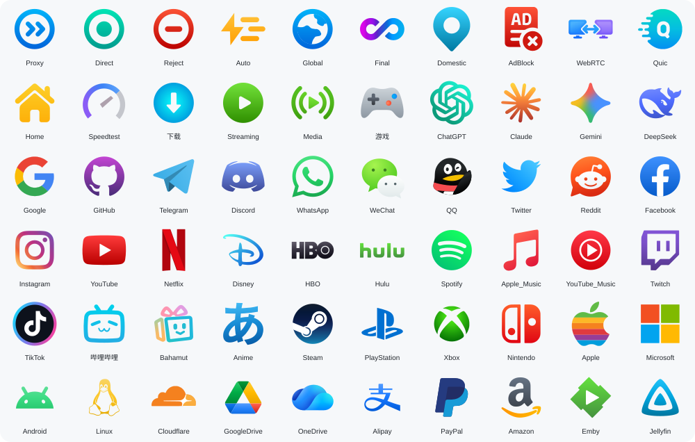
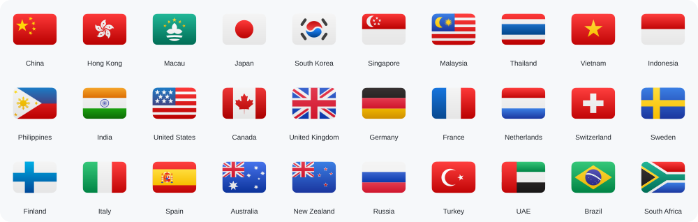

# 🐱 Mihomo / Clash Config

个人自用 Mihomo / Clash Meta 配置，提供 YAML、JS 预处理脚本和自绘 Qure 风格 SVG 图标。不提供节点或机场订阅。

## 🚀 使用方式

点击代码块右上角的复制按钮即可复制链接。

### YAML 配置

可直接导入 **FlClash 的自定义配置**：

```text
https://raw.githubusercontent.com/aaANDkk/ClashConfig/main/mihomo.yaml
```

也可下载 [mihomo.yaml](mihomo.yaml)，在 `proxy-providers` 中填入自己的订阅链接后导入。

### JS 预处理脚本

在支持订阅 JS 预处理的客户端中添加 [mihomo.js](mihomo.js)，远程脚本链接：

```text
https://raw.githubusercontent.com/aaANDkk/ClashConfig/main/mihomo.js
```

## ✨ 配置亮点

- **业务分流**：AI、Google、GitHub、Telegram、动漫和流媒体等独立分组，搭配手动选择与后台自动测速。
- **动态地区组**：JS 支持 51 个常见地区，手动可见节点满 **3 个**即生成地区组，家宽有 **1 个**即生成。直连也计数并保留在手动组，仅在自动测速中排除；YAML 使用固定分组。
- **私有 DNS**：JS 自动提取订阅中的私有 DNS，保留节点域名解析策略与 Hosts 映射。
- **拦截开关**：`AdBlock`、`WebRTC`、`QUIC` 默认 `Reject`，可切换 `Pass` 临时放行；内置部分 PCDN 屏蔽规则。

JS 仅统计客户端传入的节点，不主动下载远程 provider；未单独分组的节点仍可在 `All Proxies` 中选择。补充规则见 [动漫](rules/anime.yaml) / [流媒体](rules/media.yaml)。

## 🎨 Qure 风格 SVG 图标

**[前往图标官网 →](https://aaandkk.github.io/)**

完整图标库、分类浏览、搜索、预览与链接复制，请直接访问官网。首页仅保留固定精选，后续新增图标无需更新此处。

### 通用图标 · 精选 60 个

代理策略、广告拦截、AI、流媒体、社交与常用服务。

[](https://aaandkk.github.io/)

### 地区旗帜 · 精选 30 个

常用地区的旗帜预览，完整图标请前往官网查看。

[](https://aaandkk.github.io/)

图标为 SVG 矢量格式，文件名区分大小写。可在官网复制图标链接，用于 Mihomo / Clash 策略组：

```yaml
icon: "https://raw.githubusercontent.com/aaANDkk/Qure_Style_SVG/main/icon/svg/flag/Japan.svg"
```

## 💖 鸣谢

- [AIsouler/MyClash](https://github.com/AIsouler/MyClash)：DNS、Hosts 与策略分组处理参考。
- [Koolson/Qure](https://github.com/Koolson/Qure)：图标风格参考。
