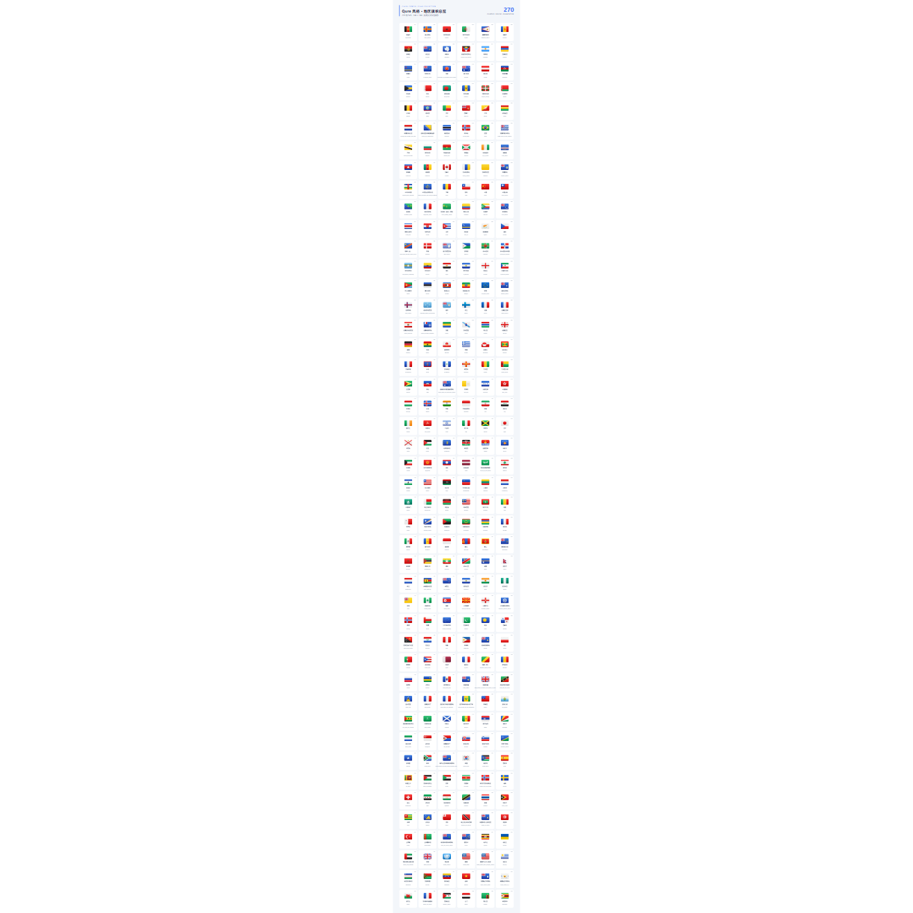

# 🐱 Mihomo / Clash Config

个人自用 Mihomo / Clash Meta 配置，提供 [YAML 配置](mihomo.yaml)、[JS 预处理脚本](mihomo.js)和自绘 Qure 风格 SVG 图标。项目不提供节点或机场订阅。

## 🚀 使用方式

YAML 与 JS 链接均放在独立代码块中，点击代码块右上角的复制按钮即可复制。

### 方式一：导入 YAML

复制下方 YAML 链接，可直接导入 **FlClash 的自定义配置**：

```text
https://raw.githubusercontent.com/aaANDkk/ClashConfig/main/mihomo.yaml
```

也可下载 [mihomo.yaml](mihomo.yaml)，在文件已有的 `proxy-providers` 区域替换订阅链接后导入。

```yaml
proxy-providers:
  Provider_A:
    <<: *airport
    url: "填入1号机场订阅"
    override:
      additional-prefix: "① "
  Provider_B:
    <<: *airport
    url: "填入2号机场订阅"
    override:
      additional-prefix: "② "
```

### 方式二：使用 JS 预处理脚本

在支持订阅 JS 预处理的客户端中添加 [mihomo.js](mihomo.js)。如果客户端支持远程脚本，可使用：

```text
https://raw.githubusercontent.com/aaANDkk/ClashConfig/main/mihomo.js
```

## ✨ 配置亮点

### 策略分组与自动测速

采用手动选择组与后台隐藏的 `url-test` 自动测速组搭配。基础策略包括 `Default`、`Direct`、`All Proxies` 和 `Residential`，业务分组包括：

`FCM` · `Google` · `AI` · `GitHub` · `Telegram` · `Twitter` · `TikTok` · `Anime` · `Media` · `Final`

AI 服务统一使用 `AI` 分组，优先选择家宽 `Residential`；JS 未识别到家宽节点时回退到 `Default`。FCM 默认直连。未命中其他规则的流量交给 `Final`。

| 地区 / 类型 | 手动选择组 | 自动测速组 |
| :--- | :--- | :--- |
| 家宽 | `Residential` | `RSD-Auto` |
| 香港 | `Hong Kong` | `HKG-Auto` |
| 中国台湾 | `Taiwan` | `TWN-Auto` |
| 日本 | `Japan` | `JPN-Auto` |
| 新加坡 | `Singapore` | `SGP-Auto` |
| 美国 | `United States` | `USA-Auto` |

| 配置方式 | 地区分组行为 |
| :--- | :--- |
| YAML | 固定保留上表分组，可自行调整筛选规则。 |
| JS | 支持 51 个常见地区；同一地区至少有 **3 个手动可见节点**时，生成手动组和隐藏自动测速组，并加入默认组及业务组的可选列表。 |

JS 还支持韩国、澳门、马来西亚、德国、英国、加拿大、澳大利亚等常见地区，使用仓库内对应的地区旗帜 SVG。分组门槛按手动列表可见的节点计数，直连类型或名称包含“直连”的节点也计入并保留在手动组；重复名称及被手动排除规则过滤的提示节点不计入。只有自动测速组排除直连类型、名称包含“直连”的节点，以及低倍率、下载节点和 Hysteria2 等配置中指定的节点。

- 地区统计基于客户端传入的 `config.proxies`，脚本不主动下载远程 `proxy-providers`；仅保留为 provider 的节点无法参与地区数量统计。
- 少于 3 个节点的地区不单独生成分组，节点仍可通过 `All Proxies` 使用；没有合适自动测速节点时，地区自动组使用 `REJECT` 兜底。
- 日本节点不足、未生成 `JPN-Auto` 时，Niconico 规则回退到 `Default`。
- JS 的家宽分组只需 **1 个手动可见的家宽节点**（包括直连节点）：识别到即生成 `Residential` 和 `RSD-Auto`，未识别到则不生成，并移除相关可选项。

### 私有 DNS 与 Hosts

YAML 提供国内、国外、AI、抖音等 DNS 分流。JS 在此基础上参考 [AIsouler/MyClash](https://github.com/AIsouler/MyClash) 的处理逻辑，从订阅中保留机场解析所需的信息：

- 从 `nameserver` 和 `proxy-server-nameserver` 提取非公共 DNS，去掉订阅原有的策略组后缀，直连标记统一为 `#DIRECT`。
- 保留匹配节点域名的显式 DNS 策略，使用私有 DNS 补齐尚未被策略覆盖的节点域名。
- 保留节点相关的 Fake-IP 排除项；仅有远程 provider 时，也保留私有节点解析 DNS 和域名策略。
- 识别依赖本地 DNS 监听地址与 Hosts 映射的订阅，按 Hosts 改写节点 `server`，保留其他连接参数。

### 拦截与媒体分流

`AdBlock`、`WebRTC`、`QUIC` 均保留独立开关，默认选择 `Reject`，可切换到 `Pass` 让流量继续匹配后续规则。

| 分组 | 作用 |
| :--- | :--- |
| `AdBlock` | Bett-rules 广告规则与 AWAvenue 秋风广告规则。 |
| `WebRTC` | 拦截配置中指定的 UDP STUN 端口流量。 |
| `QUIC` | 拦截非国内目标的 UDP 443 流量。 |

Hosts 内置部分 PCDN 域名屏蔽；动漫、流媒体分别使用 `Anime`、`Media` 分组，Niconico 优先使用日本自动测速组，Emos 固定直连。可在 [rules/anime.yaml](rules/anime.yaml) 和 [rules/media.yaml](rules/media.yaml) 中维护补充规则。

## 🎨 Qure 风格 SVG 图标

SVG 图标按用途整理，配置中已使用新的目录与文件名：

| 目录 | 内容 |
| :--- | :--- |
| [icon/svg/common](icon/svg/common) | 业务、功能与通用策略图标。 |
| [icon/svg/flag](icon/svg/flag) | 270 个旗帜图标，涵盖不同地区和组织。 |
| [icon/png](icon/png) | 保留的 PNG 素材。 |

旗帜素材数量与 JS 地区匹配数量分别为 **270** 和 **51**：素材总览展示完整收藏，脚本只配置常见机场地区。

### 地区旗帜总览 · 全部 270 个

按英文文件名排序，附中文名称。点击下图打开大图；[查看可缩放 SVG 版本](docs/assets/flags-overview.svg)，或打开[逐项图标索引](icon/svg/flag/README.md)查找原始素材。

[](docs/assets/flags-overview.png)

### 图标链接示例

```yaml
icon: "https://fastly.jsdelivr.net/gh/aaANDkk/ClashConfig@main/icon/svg/flag/Japan.svg"
```

文件名区分大小写；替换图标时，以仓库中的实际路径为准。

## ⚠️ 使用说明

本项目仅共享配置逻辑与图标素材，不提供节点或机场订阅。分流规则贴合个人使用习惯，可按网络环境调整。

## 💖 鸣谢

- [AIsouler/MyClash](https://github.com/AIsouler/MyClash)：DNS、Hosts 与策略分组处理参考。
- [Koolson/Qure](https://github.com/Koolson/Qure)：图标风格参考。
