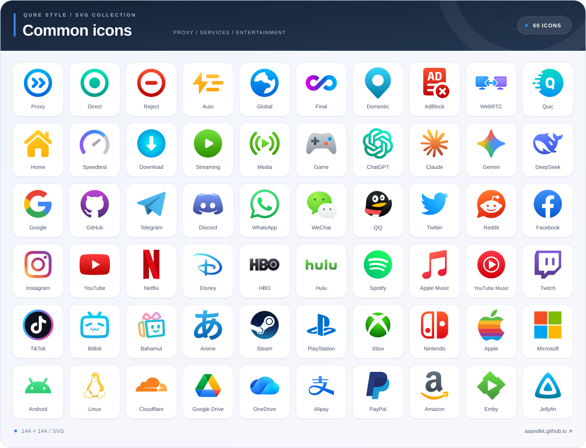
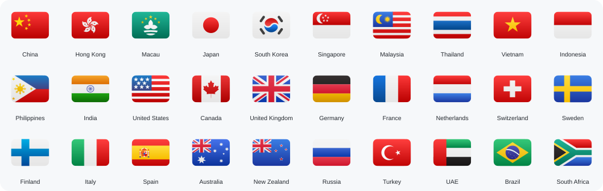

# 🐱 Mihomo / Clash Config

个人自用 Mihomo / Clash Meta 配置，提供 YAML、JS 预处理脚本和自绘 Qure 风格 SVG 图标。仓库本身不内置节点，文末附个人自用机场推荐[span_0](start_span)[span_0](end_span)。

## 🚀 使用方式

点击代码块右上角的复制按钮即可复制链接[span_1](start_span)[span_1](end_span)。

### YAML 配置

可直接导入 **FlClash 的自定义配置**：[span_2](start_span)[span_2](end_span)

```text
[https://raw.githubusercontent.com/aaANDkk/ClashConfig/main/mihomo.yaml](https://raw.githubusercontent.com/aaANDkk/ClashConfig/main/mihomo.yaml)
```

也可下载 [mihomo.yaml](mihomo.yaml)，在 `proxy-providers` 中填入自己的订阅链接后导入[span_3](start_span)[span_3](end_span)。

### JS 预处理脚本

在支持订阅 JS 预处理的客户端中添加 [mihomo.js](mihomo.js)，远程脚本链接：[span_4](start_span)[span_4](end_span)

```text
[https://raw.githubusercontent.com/aaANDkk/ClashConfig/main/mihomo.js](https://raw.githubusercontent.com/aaANDkk/ClashConfig/main/mihomo.js)
```

## ✨ 配置亮点

- **业务分流**：AI、Google、GitHub、Telegram、动漫和流媒体等独立分组，搭配手动选择与后台自动测速[span_5](start_span)[span_5](end_span)。
- **动态地区组**：JS 支持 51 个常见地区，手动可见节点满 **3 个**即生成地区组，家宽有 **1 个**即生成。直连也计数并保留在手动组，仅在自动测速中排除；YAML 使用固定分组[span_6](start_span)[span_6](end_span)。
- **私有 DNS**：JS 自动提取订阅中的私有 DNS，保留节点域名解析策略与 Hosts 映射[span_7](start_span)[span_7](end_span)。
- **拦截开关**：`AdBlock`、`WebRTC`、`QUIC` 默认 `Reject`，可切换 `Pass` 临时放行；内置部分 PCDN 屏蔽规则[span_8](start_span)[span_8](end_span)。

JS 仅统计客户端传入的节点，不主动下载远程 provider；未单独分组的节点仍可在 `All Proxies` 中选择[span_9](start_span)[span_9](end_span)。补充规则见 [动漫](rules/anime.yaml) / [流媒体](rules/media.yaml)[span_10](start_span)[span_10](end_span)。

## ✈️ 自用机场推荐

> 以下均为本人日常自用且与本配置兼容性较好的机场，链接含个人邀请码，按需选择即可[span_11](start_span)[span_11](end_span)。

| 机场名称 | 线路类型 | 特点与备注 | 优惠码 | 注册地址 |
| :--- | :--- | :--- | :--- | :--- |
| **百变小樱** | 专线[span_12](start_span)[span_12](end_span) | 小众低调，价格适中，含家宽节点；每日签到基本一次可得 5–10G 流量[span_13](start_span)[span_13](end_span) | `Bettbox68`[span_14](start_span)[span_14](end_span) | [点击注册](https://www.bbxy01.net/v2/register?code=jXqG)[span_15](start_span)[span_15](end_span) |
| **ikuuu** | 专线[span_16](start_span)[span_16](end_span) | 老牌机场，价格十分便宜，入门首选；节点纯净度略逊于小樱，每日签到约得 2G 流量[span_17](start_span)[span_17](end_span) | — | [点击注册](https://ikuuu.top/auth/register?code=s5UM)[span_18](start_span)[span_18](end_span) |
| **Lumina** | 直连 + 专线[span_19](start_span)[span_19](end_span) | 更加小众，含家宽节点；套餐类型较多，购买前请仔细阅读套餐说明[span_20](start_span)[span_20](end_span) | — | [点击注册](https://luminak.net/#/register?code=iNvysL8C)[span_21](start_span)[span_21](end_span) |
| **NIVA** | 直连 | 主打家宽（家宽节点非常多），价格便宜；通过下方邀请链接注册可免费使用 | — | [点击注册](https://niva.sh/r/nh6k) |

## 🎨 Qure 风格 SVG 图标

**[前往图标预览站 →](https://aaandkk.github.io/qure/)**[span_22](start_span)[span_22](end_span)

搜索、预览、下载图标及复制链接，请访问预览网站[span_23](start_span)[span_23](end_span)。

### 通用图标 · 精选 60 个

代理策略、广告拦截、AI、流媒体、社交与常用服务。完整图标请前往[图标预览站](https://aaandkk.github.io/qure/)查看[span_24](start_span)[span_24](end_span)。

[](https://aaandkk.github.io/qure/)[span_25](start_span)[span_25](end_span)

### 地区旗帜 · 精选 30 个

常用地区的旗帜预览。完整图标请前往[图标预览站](https://aaandkk.github.io/qure/)查看[span_26](start_span)[span_26](end_span)。

[](https://aaandkk.github.io/qure/)[span_27](start_span)[span_27](end_span)

## 🔗 单个图标使用

在[图标预览站](https://aaandkk.github.io/qure/)搜索图标并复制链接，也可使用以下原始文件链接（文件名区分大小写）：[span_28](start_span)[span_28](end_span)

- **通用图标示例**：[span_29](start_span)[span_29](end_span)
  ```text
  [https://raw.githubusercontent.com/aaANDkk/Qure_Style_SVG/main/icon/svg/common/ChatGPT.svg](https://raw.githubusercontent.com/aaANDkk/Qure_Style_SVG/main/icon/svg/common/ChatGPT.svg)
  ```

- **旗帜图标示例**：[span_30](start_span)[span_30](end_span)
  ```text
  [https://raw.githubusercontent.com/aaANDkk/Qure_Style_SVG/main/icon/svg/flag/Japan.svg](https://raw.githubusercontent.com/aaANDkk/Qure_Style_SVG/main/icon/svg/flag/Japan.svg)
  ```

- **Mihomo / Clash 配置示例**：[span_31](start_span)[span_31](end_span)
  ```yaml
  icon: "[https://raw.githubusercontent.com/aaANDkk/Qure_Style_SVG/main/icon/svg/flag/Japan.svg](https://raw.githubusercontent.com/aaANDkk/Qure_Style_SVG/main/icon/svg/flag/Japan.svg)"
  ```

---

## 💖 鸣谢

- [AIsouler/MyClash](https://github.com/AIsouler/MyClash)：DNS、Hosts 与策略分组处理参考[span_32](start_span)[span_32](end_span)。
- [Koolson/Qure](https://github.com/Koolson/Qure)：图标风格参考[span_33](start_span)[span_33](end_span)。
