# Qure 风格地区旗帜素材索引

共 **270** 个 SVG，统一为 **144×144**。按英文文件名排序，点击图标或文件名可查看原始素材。

[返回项目说明](../../../README.md) · [PNG 总览](../../../docs/assets/flags-overview.png?v=0d6891dccb28) · [可缩放 SVG 总览](../../../docs/assets/flags-overview.svg?v=671c9fd3a11c)

素材库展示全部地区和组织旗帜；JS 仅匹配 51 个常见机场地区。

| 预览 | 用途 / 名称 | SVG 文件 |
| :---: | :--- | :--- |
|  | 阿富汗 | [Afghanistan.svg](Afghanistan.svg) |
|  | 奥兰群岛 | [Aland_Islands.svg](Aland_Islands.svg) |
|  | 阿尔巴尼亚 | [Albania.svg](Albania.svg) |
|  | 阿尔及利亚 | [Algeria.svg](Algeria.svg) |
|  | 美属萨摩亚 | [American_Samoa.svg](American_Samoa.svg) |
|  | 安道尔 | [Andorra.svg](Andorra.svg) |
|  | 安哥拉 | [Angola.svg](Angola.svg) |
|  | 安圭拉 | [Anguilla.svg](Anguilla.svg) |
| [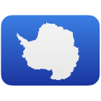](Antarctica.svg) | 南极洲 | [Antarctica.svg](Antarctica.svg) |
|  | 安提瓜和巴布达 | [Antigua_and_Barbuda.svg](Antigua_and_Barbuda.svg) |
| [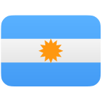](Argentina.svg) | 阿根廷 | [Argentina.svg](Argentina.svg) |
|  | 亚美尼亚 | [Armenia.svg](Armenia.svg) |
|  | 阿鲁巴 | [Aruba.svg](Aruba.svg) |
|  | 阿森松岛 | [Ascension_Island.svg](Ascension_Island.svg) |
|  | 东盟 | [Association_of_Southeast_Asian_Nations.svg](Association_of_Southeast_Asian_Nations.svg) |
|  | 澳大利亚 | [Australia.svg](Australia.svg) |
|  | 奥地利 | [Austria.svg](Austria.svg) |
| [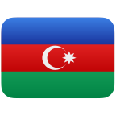](Azerbaijan.svg) | 阿塞拜疆 | [Azerbaijan.svg](Azerbaijan.svg) |
|  | 巴哈马 | [Bahamas.svg](Bahamas.svg) |
|  | 巴林 | [Bahrain.svg](Bahrain.svg) |
|  | 孟加拉国 | [Bangladesh.svg](Bangladesh.svg) |
|  | 巴巴多斯 | [Barbados.svg](Barbados.svg) |
| [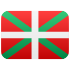](Basque_Country.svg) | 巴斯克地区 | [Basque_Country.svg](Basque_Country.svg) |
|  | 白俄罗斯 | [Belarus.svg](Belarus.svg) |
|  | 比利时 | [Belgium.svg](Belgium.svg) |
|  | 伯利兹 | [Belize.svg](Belize.svg) |
|  | 贝宁 | [Benin.svg](Benin.svg) |
|  | 百慕大 | [Bermuda.svg](Bermuda.svg) |
|  | 不丹 | [Bhutan.svg](Bhutan.svg) |
|  | 玻利维亚 | [Bolivia.svg](Bolivia.svg) |
|  | 荷属加勒比区 | [Bonaire_Sint_Eustatius_and_Saba.svg](Bonaire_Sint_Eustatius_and_Saba.svg) |
|  | 波斯尼亚和黑塞哥维那 | [Bosnia_and_Herzegovina.svg](Bosnia_and_Herzegovina.svg) |
|  | 博茨瓦纳 | [Botswana.svg](Botswana.svg) |
|  | 布韦岛 | [Bouvet_Island.svg](Bouvet_Island.svg) |
|  | 巴西 | [Brazil.svg](Brazil.svg) |
|  | 英属印度洋领地 | [British_Indian_Ocean_Territory.svg](British_Indian_Ocean_Territory.svg) |
|  | 文莱 | [Brunei_Darussalam.svg](Brunei_Darussalam.svg) |
|  | 保加利亚 | [Bulgaria.svg](Bulgaria.svg) |
| [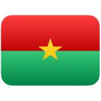](Burkina_Faso.svg) | 布基纳法索 | [Burkina_Faso.svg](Burkina_Faso.svg) |
|  | 布隆迪 | [Burundi.svg](Burundi.svg) |
|  | 科特迪瓦 | [C_te_d_Ivoire.svg](C_te_d_Ivoire.svg) |
|  | 佛得角 | [Cabo_Verde.svg](Cabo_Verde.svg) |
|  | 柬埔寨 | [Cambodia.svg](Cambodia.svg) |
|  | 喀麦隆 | [Cameroon.svg](Cameroon.svg) |
|  | 加拿大 | [Canada.svg](Canada.svg) |
|  | 加纳利群岛 | [Canary_Islands.svg](Canary_Islands.svg) |
|  | 加泰罗尼亚 | [Catalonia.svg](Catalonia.svg) |
|  | 开曼群岛 | [Cayman_Islands.svg](Cayman_Islands.svg) |
|  | 中非共和国 | [Central_African_Republic.svg](Central_African_Republic.svg) |
|  | 中欧自由贸易协定 | [Central_European_Free_Trade_Agreement.svg](Central_European_Free_Trade_Agreement.svg) |
|  | 乍得 | [Chad.svg](Chad.svg) |
|  | 智利 | [Chile.svg](Chile.svg) |
|  | 中国 | [China.svg](China.svg) |
|  | 中国台湾 | [China_Taiwan.svg](China_Taiwan.svg) |
|  | 圣诞岛 | [Christmas_Island.svg](Christmas_Island.svg) |
|  | 克利珀顿岛 | [Clipperton_Island.svg](Clipperton_Island.svg) |
|  | 科科斯（基林）群岛 | [Cocos_Keeling_Islands.svg](Cocos_Keeling_Islands.svg) |
|  | 哥伦比亚 | [Colombia.svg](Colombia.svg) |
| [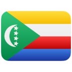](Comoros.svg) | 科摩罗 | [Comoros.svg](Comoros.svg) |
|  | 库克群岛 | [Cook_Islands.svg](Cook_Islands.svg) |
|  | 哥斯达黎加 | [Costa_Rica.svg](Costa_Rica.svg) |
|  | 克罗地亚 | [Croatia.svg](Croatia.svg) |
|  | 古巴 | [Cuba.svg](Cuba.svg) |
|  | 库拉索 | [Cura_ao.svg](Cura_ao.svg) |
|  | 塞浦路斯 | [Cyprus.svg](Cyprus.svg) |
|  | 捷克 | [Czechia.svg](Czechia.svg) |
|  | 刚果（金） | [Democratic_Republic_of_the_Congo.svg](Democratic_Republic_of_the_Congo.svg) |
|  | 丹麦 | [Denmark.svg](Denmark.svg) |
|  | 迪戈加西亚岛 | [Diego_Garcia.svg](Diego_Garcia.svg) |
| [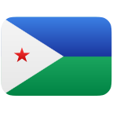](Djibouti.svg) | 吉布提 | [Djibouti.svg](Djibouti.svg) |
|  | 多米尼克 | [Dominica.svg](Dominica.svg) |
|  | 多米尼加共和国 | [Dominican_Republic.svg](Dominican_Republic.svg) |
|  | 东非共同体 | [East_African_Community.svg](East_African_Community.svg) |
|  | 厄瓜多尔 | [Ecuador.svg](Ecuador.svg) |
|  | 埃及 | [Egypt.svg](Egypt.svg) |
|  | 萨尔瓦多 | [El_Salvador.svg](El_Salvador.svg) |
|  | 英格兰 | [England.svg](England.svg) |
|  | 赤道几内亚 | [Equatorial_Guinea.svg](Equatorial_Guinea.svg) |
|  | 厄立特里亚 | [Eritrea.svg](Eritrea.svg) |
|  | 爱沙尼亚 | [Estonia.svg](Estonia.svg) |
|  | 斯威士兰 | [Eswatini.svg](Eswatini.svg) |
|  | 埃塞俄比亚 | [Ethiopia.svg](Ethiopia.svg) |
|  | 欧盟 | [European_Union.svg](European_Union.svg) |
|  | 福克兰群岛 | [Falkland_Islands.svg](Falkland_Islands.svg) |
|  | 法罗群岛 | [Faroe_Islands.svg](Faroe_Islands.svg) |
|  | 密克罗尼西亚 | [Federated_States_of_Micronesia.svg](Federated_States_of_Micronesia.svg) |
|  | 斐济 | [Fiji.svg](Fiji.svg) |
|  | 芬兰 | [Finland.svg](Finland.svg) |
|  | 法国 | [France.svg](France.svg) |
|  | 法属圭亚那 | [French_Guiana.svg](French_Guiana.svg) |
| [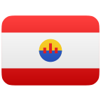](French_Polynesia.svg) | 法属波利尼西亚 | [French_Polynesia.svg](French_Polynesia.svg) |
|  | 法属南部领地 | [French_Southern_Territories.svg](French_Southern_Territories.svg) |
|  | 加蓬 | [Gabon.svg](Gabon.svg) |
|  | 加利西亚 | [Galicia.svg](Galicia.svg) |
| [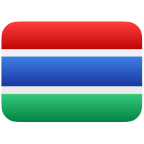](Gambia.svg) | 冈比亚 | [Gambia.svg](Gambia.svg) |
|  | 格鲁吉亚 | [Georgia.svg](Georgia.svg) |
|  | 德国 | [Germany.svg](Germany.svg) |
|  | 加纳 | [Ghana.svg](Ghana.svg) |
|  | 直布罗陀 | [Gibraltar.svg](Gibraltar.svg) |
|  | 希腊 | [Greece.svg](Greece.svg) |
|  | 格陵兰 | [Greenland.svg](Greenland.svg) |
|  | 格林纳达 | [Grenada.svg](Grenada.svg) |
|  | 瓜德罗普 | [Guadeloupe.svg](Guadeloupe.svg) |
|  | 关岛 | [Guam.svg](Guam.svg) |
|  | 危地马拉 | [Guatemala.svg](Guatemala.svg) |
|  | 根西岛 | [Guernsey.svg](Guernsey.svg) |
|  | 几内亚 | [Guinea.svg](Guinea.svg) |
|  | 几内亚比绍 | [Guinea_Bissau.svg](Guinea_Bissau.svg) |
|  | 圭亚那 | [Guyana.svg](Guyana.svg) |
|  | 海地 | [Haiti.svg](Haiti.svg) |
|  | 赫德岛和麦克唐纳群岛 | [Heard_Island_and_McDonald_Islands.svg](Heard_Island_and_McDonald_Islands.svg) |
|  | 梵蒂冈 | [Holy_See.svg](Holy_See.svg) |
|  | 洪都拉斯 | [Honduras.svg](Honduras.svg) |
|  | 中国香港 | [Hong_Kong.svg](Hong_Kong.svg) |
|  | 匈牙利 | [Hungary.svg](Hungary.svg) |
|  | 冰岛 | [Iceland.svg](Iceland.svg) |
|  | 印度 | [India.svg](India.svg) |
|  | 印度尼西亚 | [Indonesia.svg](Indonesia.svg) |
|  | 伊朗 | [Iran.svg](Iran.svg) |
|  | 伊拉克 | [Iraq.svg](Iraq.svg) |
|  | 爱尔兰 | [Ireland.svg](Ireland.svg) |
|  | 马恩岛 | [Isle_of_Man.svg](Isle_of_Man.svg) |
|  | 以色列 | [Israel.svg](Israel.svg) |
|  | 意大利 | [Italy.svg](Italy.svg) |
|  | 牙买加 | [Jamaica.svg](Jamaica.svg) |
|  | 日本 | [Japan.svg](Japan.svg) |
|  | 泽西岛 | [Jersey.svg](Jersey.svg) |
|  | 约旦 | [Jordan.svg](Jordan.svg) |
|  | 哈萨克斯坦 | [Kazakhstan.svg](Kazakhstan.svg) |
|  | 肯尼亚 | [Kenya.svg](Kenya.svg) |
| [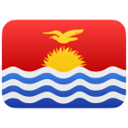](Kiribati.svg) | 基里巴斯 | [Kiribati.svg](Kiribati.svg) |
|  | 科索沃 | [Kosovo.svg](Kosovo.svg) |
|  | 科威特 | [Kuwait.svg](Kuwait.svg) |
|  | 吉尔吉斯斯坦 | [Kyrgyzstan.svg](Kyrgyzstan.svg) |
|  | 老挝 | [Laos.svg](Laos.svg) |
|  | 拉脱维亚 | [Latvia.svg](Latvia.svg) |
|  | 阿拉伯国家联盟 | [League_of_Arab_States.svg](League_of_Arab_States.svg) |
|  | 黎巴嫩 | [Lebanon.svg](Lebanon.svg) |
|  | 莱索托 | [Lesotho.svg](Lesotho.svg) |
|  | 利比里亚 | [Liberia.svg](Liberia.svg) |
|  | 利比亚 | [Libya.svg](Libya.svg) |
|  | 列支敦士登 | [Liechtenstein.svg](Liechtenstein.svg) |
|  | 立陶宛 | [Lithuania.svg](Lithuania.svg) |
|  | 卢森堡 | [Luxembourg.svg](Luxembourg.svg) |
|  | 中国澳门 | [Macau.svg](Macau.svg) |
|  | 马达加斯加 | [Madagascar.svg](Madagascar.svg) |
|  | 马拉维 | [Malawi.svg](Malawi.svg) |
|  | 马来西亚 | [Malaysia.svg](Malaysia.svg) |
|  | 马尔代夫 | [Maldives.svg](Maldives.svg) |
|  | 马里 | [Mali.svg](Mali.svg) |
|  | 马耳他 | [Malta.svg](Malta.svg) |
|  | 马绍尔群岛 | [Marshall_Islands.svg](Marshall_Islands.svg) |
|  | 马提尼克 | [Martinique.svg](Martinique.svg) |
| [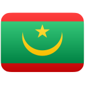](Mauritania.svg) | 毛里塔尼亚 | [Mauritania.svg](Mauritania.svg) |
|  | 毛里求斯 | [Mauritius.svg](Mauritius.svg) |
|  | 马约特 | [Mayotte.svg](Mayotte.svg) |
|  | 墨西哥 | [Mexico.svg](Mexico.svg) |
|  | 摩尔多瓦 | [Moldova.svg](Moldova.svg) |
|  | 摩纳哥 | [Monaco.svg](Monaco.svg) |
|  | 蒙古 | [Mongolia.svg](Mongolia.svg) |
|  | 黑山 | [Montenegro.svg](Montenegro.svg) |
|  | 蒙特塞拉特 | [Montserrat.svg](Montserrat.svg) |
| [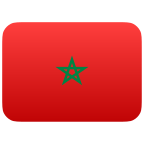](Morocco.svg) | 摩洛哥 | [Morocco.svg](Morocco.svg) |
| [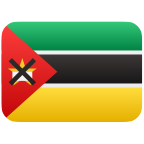](Mozambique.svg) | 莫桑比克 | [Mozambique.svg](Mozambique.svg) |
|  | 缅甸 | [Myanmar.svg](Myanmar.svg) |
| [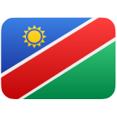](Namibia.svg) | 纳米比亚 | [Namibia.svg](Namibia.svg) |
|  | 瑙鲁 | [Nauru.svg](Nauru.svg) |
|  | 尼泊尔 | [Nepal.svg](Nepal.svg) |
|  | 荷兰 | [Netherlands.svg](Netherlands.svg) |
|  | 新喀里多尼亚 | [New_Caledonia.svg](New_Caledonia.svg) |
|  | 新西兰 | [New_Zealand.svg](New_Zealand.svg) |
|  | 尼加拉瓜 | [Nicaragua.svg](Nicaragua.svg) |
| [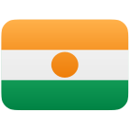](Niger.svg) | 尼日尔 | [Niger.svg](Niger.svg) |
|  | 尼日利亚 | [Nigeria.svg](Nigeria.svg) |
|  | 纽埃 | [Niue.svg](Niue.svg) |
|  | 诺福克岛 | [Norfolk_Island.svg](Norfolk_Island.svg) |
|  | 朝鲜 | [North_Korea.svg](North_Korea.svg) |
|  | 北马其顿 | [North_Macedonia.svg](North_Macedonia.svg) |
|  | 北爱尔兰 | [Northern_Ireland.svg](Northern_Ireland.svg) |
|  | 北马里亚纳群岛 | [Northern_Mariana_Islands.svg](Northern_Mariana_Islands.svg) |
|  | 挪威 | [Norway.svg](Norway.svg) |
|  | 阿曼 | [Oman.svg](Oman.svg) |
|  | 太平洋共同体 | [Pacific_Community.svg](Pacific_Community.svg) |
|  | 巴基斯坦 | [Pakistan.svg](Pakistan.svg) |
|  | 帕劳 | [Palau.svg](Palau.svg) |
|  | 巴拿马 | [Panama.svg](Panama.svg) |
|  | 巴布亚新几内亚 | [Papua_New_Guinea.svg](Papua_New_Guinea.svg) |
| [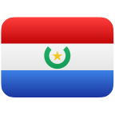](Paraguay.svg) | 巴拉圭 | [Paraguay.svg](Paraguay.svg) |
|  | 秘鲁 | [Peru.svg](Peru.svg) |
|  | 菲律宾 | [Philippines.svg](Philippines.svg) |
|  | 皮特凯恩群岛 | [Pitcairn.svg](Pitcairn.svg) |
|  | 波兰 | [Poland.svg](Poland.svg) |
|  | 葡萄牙 | [Portugal.svg](Portugal.svg) |
|  | 波多黎各 | [Puerto_Rico.svg](Puerto_Rico.svg) |
|  | 卡塔尔 | [Qatar.svg](Qatar.svg) |
|  | 留尼汪 | [R_union.svg](R_union.svg) |
|  | 刚果（布） | [Republic_of_the_Congo.svg](Republic_of_the_Congo.svg) |
|  | 罗马尼亚 | [Romania.svg](Romania.svg) |
| [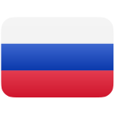](Russia.svg) | 俄罗斯 | [Russia.svg](Russia.svg) |
| [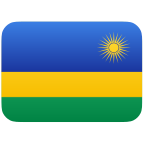](Rwanda.svg) | 卢旺达 | [Rwanda.svg](Rwanda.svg) |
|  | 圣巴泰勒米 | [Saint_Barth_lemy.svg](Saint_Barth_lemy.svg) |
|  | 圣赫勒拿 | [Saint_Helena.svg](Saint_Helena.svg) |
|  | 圣赫勒拿 | [Saint_Helena_Ascension_and_Tristan_da_Cunha.svg](Saint_Helena_Ascension_and_Tristan_da_Cunha.svg) |
|  | 圣基茨和尼维斯 | [Saint_Kitts_and_Nevis.svg](Saint_Kitts_and_Nevis.svg) |
|  | 圣卢西亚 | [Saint_Lucia.svg](Saint_Lucia.svg) |
|  | 法属圣马丁 | [Saint_Martin.svg](Saint_Martin.svg) |
|  | 圣皮埃尔和密克隆群岛 | [Saint_Pierre_and_Miquelon.svg](Saint_Pierre_and_Miquelon.svg) |
|  | 圣文森特和格林纳丁斯 | [Saint_Vincent_and_the_Grenadines.svg](Saint_Vincent_and_the_Grenadines.svg) |
|  | 萨摩亚 | [Samoa.svg](Samoa.svg) |
|  | 圣马力诺 | [San_Marino.svg](San_Marino.svg) |
|  | 圣多美和普林西比 | [Sao_Tome_and_Principe.svg](Sao_Tome_and_Principe.svg) |
|  | 沙特阿拉伯 | [Saudi_Arabia.svg](Saudi_Arabia.svg) |
|  | 苏格兰 | [Scotland.svg](Scotland.svg) |
|  | 塞内加尔 | [Senegal.svg](Senegal.svg) |
|  | 塞尔维亚 | [Serbia.svg](Serbia.svg) |
|  | 塞舌尔 | [Seychelles.svg](Seychelles.svg) |
|  | 塞拉利昂 | [Sierra_Leone.svg](Sierra_Leone.svg) |
|  | 新加坡 | [Singapore.svg](Singapore.svg) |
|  | 荷属圣马丁 | [Sint_Maarten.svg](Sint_Maarten.svg) |
|  | 斯洛伐克 | [Slovakia.svg](Slovakia.svg) |
|  | 斯洛文尼亚 | [Slovenia.svg](Slovenia.svg) |
| [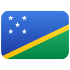](Solomon_Islands.svg) | 所罗门群岛 | [Solomon_Islands.svg](Solomon_Islands.svg) |
|  | 索马里 | [Somalia.svg](Somalia.svg) |
|  | 南非 | [South_Africa.svg](South_Africa.svg) |
| [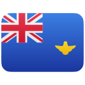](South_Georgia_and_the_South_Sandwich_Islands.svg) | 南乔治亚和南桑威奇群岛 | [South_Georgia_and_the_South_Sandwich_Islands.svg](South_Georgia_and_the_South_Sandwich_Islands.svg) |
|  | 韩国 | [South_Korea.svg](South_Korea.svg) |
|  | 南苏丹 | [South_Sudan.svg](South_Sudan.svg) |
|  | 西班牙 | [Spain.svg](Spain.svg) |
|  | 斯里兰卡 | [Sri_Lanka.svg](Sri_Lanka.svg) |
|  | 巴勒斯坦领土 | [State_of_Palestine.svg](State_of_Palestine.svg) |
|  | 苏丹 | [Sudan.svg](Sudan.svg) |
| [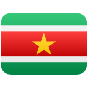](Suriname.svg) | 苏里南 | [Suriname.svg](Suriname.svg) |
|  | 斯瓦尔巴和扬马延 | [Svalbard_and_Jan_Mayen.svg](Svalbard_and_Jan_Mayen.svg) |
|  | 瑞典 | [Sweden.svg](Sweden.svg) |
|  | 瑞士 | [Switzerland.svg](Switzerland.svg) |
|  | 叙利亚 | [Syria.svg](Syria.svg) |
| [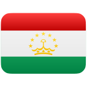](Tajikistan.svg) | 塔吉克斯坦 | [Tajikistan.svg](Tajikistan.svg) |
| [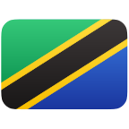](Tanzania.svg) | 坦桑尼亚 | [Tanzania.svg](Tanzania.svg) |
|  | 泰国 | [Thailand.svg](Thailand.svg) |
| [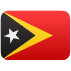](Timor_Leste.svg) | 东帝汶 | [Timor_Leste.svg](Timor_Leste.svg) |
|  | 多哥 | [Togo.svg](Togo.svg) |
|  | 托克劳 | [Tokelau.svg](Tokelau.svg) |
|  | 汤加 | [Tonga.svg](Tonga.svg) |
|  | 特立尼达和多巴哥 | [Trinidad_and_Tobago.svg](Trinidad_and_Tobago.svg) |
|  | 特里斯坦-达库尼亚 | [Tristan_da_Cunha.svg](Tristan_da_Cunha.svg) |
|  | 突尼斯 | [Tunisia.svg](Tunisia.svg) |
|  | 土耳其 | [Turkey.svg](Turkey.svg) |
|  | 土库曼斯坦 | [Turkmenistan.svg](Turkmenistan.svg) |
|  | 特克斯和凯科斯群岛 | [Turks_and_Caicos_Islands.svg](Turks_and_Caicos_Islands.svg) |
|  | 图瓦卢 | [Tuvalu.svg](Tuvalu.svg) |
|  | 乌干达 | [Uganda.svg](Uganda.svg) |
|  | 乌克兰 | [Ukraine.svg](Ukraine.svg) |
|  | 阿拉伯联合酋长国 | [United_Arab_Emirates.svg](United_Arab_Emirates.svg) |
|  | 英国 | [United_Kingdom.svg](United_Kingdom.svg) |
|  | 联合国 | [United_Nations.svg](United_Nations.svg) |
|  | 美国 | [United_States.svg](United_States.svg) |
|  | 美国本土外小岛屿 | [United_States_Minor_Outlying_Islands.svg](United_States_Minor_Outlying_Islands.svg) |
|  | 乌拉圭 | [Uruguay.svg](Uruguay.svg) |
| [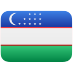](Uzbekistan.svg) | 乌兹别克斯坦 | [Uzbekistan.svg](Uzbekistan.svg) |
|  | 瓦努阿图 | [Vanuatu.svg](Vanuatu.svg) |
| [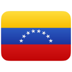](Venezuela.svg) | 委内瑞拉 | [Venezuela.svg](Venezuela.svg) |
|  | 越南 | [Vietnam.svg](Vietnam.svg) |
|  | 英属维尔京群岛 | [Virgin_Islands_British.svg](Virgin_Islands_British.svg) |
|  | 美属维尔京群岛 | [Virgin_Islands_U_S.svg](Virgin_Islands_U_S.svg) |
|  | 威尔士 | [Wales.svg](Wales.svg) |
|  | 瓦利斯和富图纳 | [Wallis_and_Futuna.svg](Wallis_and_Futuna.svg) |
|  | 西撒哈拉 | [Western_Sahara.svg](Western_Sahara.svg) |
|  | 也门 | [Yemen.svg](Yemen.svg) |
|  | 赞比亚 | [Zambia.svg](Zambia.svg) |
|  | 津巴布韦 | [Zimbabwe.svg](Zimbabwe.svg) |
